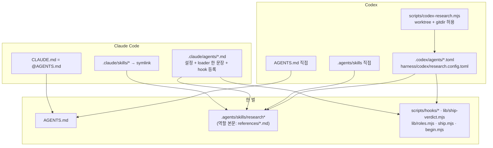

# 연구 체인의 Claude Code · Codex 대응

이 저장소의 연구 체인을 두 harness 에서 같은 절차로 돌리기 위한 유지보수 문서다. 체인을 고치거나, Claude Code 나 Codex 가
바뀌었을 때 이 문서로 시작한다. 설치는 `README.md`, 규칙이 생긴 이유는 `docs/method-provenance.md` 가 갖는다.

**한 곳만 고친다.** 지침, 역할의 행동, 판정은 한 벌이다. harness 파일에는 설정과 "본문을 읽어라" 한 문장만 있고,
`node scripts/check-harness.mjs` 가 어긋남을 CI 에서 막는다. 같은 내용을 두 파일에 써야 할 것 같으면, 그것을 공용 파일로
옮길 수 없는 이유부터 이 문서에 적는다.



## 1. 대응표

"확인"은 그 행을 마지막으로 실측한 버전과 방법이다. 버전이 오르면 `node scripts/check-harness.mjs --versions` 가
다시 볼 행을 알린다.

| # | 개념 | Claude Code | Codex | 확인 |
|---|---|---|---|---|
| 1 | 저장소 지침 | `CLAUDE.md` 의 `@AGENTS.md` import | `AGENTS.md` 를 직접 읽는다 | 문서 [C-memory], [X-agentsmd] |
| 2 | skill | `.claude/skills/<이름>` → `.agents/skills/<이름>` symlink. Claude 는 `.agents/` 를 읽지 않는다 | `.agents/skills/` 를 직접 읽는다 | check-harness `skill-link`; 문서 [C-skills], [X-skills] |
| 3 | researcher 진입 | research skill → `researcher` subagent(`isolation: worktree`, `background: true`) | `scripts/codex-research.mjs` 가 연 profile 세션이 곧 researcher. researcher agent 는 없다 | V3·V5 (§3) |
| 4 | 역할 정의 | `.claude/agents/<역할>.md` | `.codex/agents/<역할>.toml`, researcher 는 profile 의 `developer_instructions` | check-harness `roles`·`loader`·`loader-only`·`description` |
| 5 | lens 띄우기 | Agent 도구, `subagent_type`, 한 메시지에 둘. 대화형 세션에서는 background 로 돈다(Claude Code 기본) | `spawn_agent`, `agent_type`, `fork_turns:"none"` | V3·V5 |
| 6 | lens 맥락 격리 | 이름 있는 subagent 는 새 맥락으로 시작한다. 띄운 프롬프트를 start 기록에 남긴다 | 모델이 `fork_turns` 를 고른다(probe 에서 `"all"` 을 골랐다). `"none"` 이 아니면 pretool 이 거부한다. hook 입력의 spawn 메시지는 암호화돼 있어 남기지 않는다 | V3 프롬프트 기록(Claude), hooks.test, probe 2026-10-27 |
| 7 | lens 병렬 | 같은 메시지의 두 Agent 호출 | profile `[agents] max_concurrent_threads_per_session = 4` | 판정: start 둘이 첫 done 보다 앞선다 |
| 8a | Codex profile 설치 | 해당 없음 | 시작 스크립트가 부를 때마다 `harness/codex/research.config.toml` 을 `${CODEX_HOME}/research.config.toml` 로 복사하고 `[hooks.state]` 를 이어 붙인다 | V3(Codex) 2026-10-27: 저장소 파일이 바뀌지 않았다 |
| 8 | researcher 권한 | researcher frontmatter 의 PreToolUse 가 허용한다 | permission profile `research` + 시작 스크립트의 `research-run`(상속 + 정확한 gitdir 쓰기) | `codex sandbox -P research-run` commit·cache·network (0.164.0) |
| 9 | lens 쓰기 막기 | `disallowedTools` + pretool 의 쓰기 도구 거부 | pretool 이 `agent_type` 으로 `apply_patch` 거부 | hooks.test |
| 10 | 검토 시작 기록 | researcher 의 PreToolUse(Agent) | profile 의 `SubagentStart`(matcher = REVIEWERS) | hooks.test, V3·V5 |
| 11 | 검토 완료 기록 | lens 정의의 Stop(→SubagentStop) | profile 의 `SubagentStop`(matcher = REVIEWERS) | hooks.test, V3·V5 |
| 12 | 게이트 | researcher 정의의 Stop(→SubagentStop) → `gates.mjs` | profile 의 Stop → `gates.mjs` | V3·V5 |
| 13 | hook trust | 폴더 trust. 없으면 frontmatter hook 을 건너뛴다(trust 키는 worktree 가 아니라 저장소 root) | `/hooks` 의 hash trust. 기록은 profile 파일의 `[hooks.state]` 에 쓰인다(그래서 profile 은 symlink 가 아니라 복사본). trust 전에 시작한 turn 에서는 SubagentStart·SubagentStop 이 돌지 않는다. 시작 스크립트가 그때 요청을 넘기지 않는다 | V3(Claude), V5·V3(Codex) 2026-10-27 |
| 14 | 모델 관찰(보조) | researcher transcript, lens 의 PostToolUse `resolvedModel`·`modelsUsed`(foreground 만). V3 에서 행위자 4/4, v8(background lens) 에서 5/5 | `logs_2.sqlite` 의 "server reported model". 0.164.0 실제 서버 세션에서는 0줄이라 늘 "확인 못 함" | §2 임시 어댑터 |
| 15 | 사용량 | `scripts/hooks/usage/claude.mjs` | `scripts/hooks/usage/codex.mjs`(thread 누적, 자식 모름) | V3·V5 hooks.json `usage` |
| 16 | 서명 | `Co-Authored-By: Claude` | `Generated-with: Codex CLI` | ship.mjs `ATTRIBUTION` |
| 17 | lens 가 읽는 동안 | 렌즈 start 때 `.research/lens-window.json` 을 열고 두 done 에 닫는다. 편집 도구로 문서·원장을 쓰면 pretool 이 거부, 셸로 바뀌면 PostToolUse(Bash) 의 `window.mjs` 가 바뀐 파일을 알린다 | 같은 창을 SubagentStart·Stop 이 연다·닫는다. `apply_patch` 의 파일 줄로 거부, PostToolUse(`Bash`/`apply_patch`) 로 알림 | hooks.test, 창 없을 때 호출당 약 19ms(빈 node 13ms) |
| 18 | recheck 상한 | 세 번째 recheck 를 pretool 이 거부 | 같음 | hooks.test |
| 19 | 검토 모델 등급 | `scripts/lib/roles.mjs` 의 TIER·MODEL, check-harness `role-model` | 같음 | 2026-10-28: frontier 로 올린 run 도 함정을 놓쳤으나 effort 가 medium 이었다. workhorse 를 high 로 돌린 v8 이 잡아 workhorse 유지 |
| 20 | 역할 effort | `scripts/lib/roles.mjs` 의 harness 별 EFFORT. agent frontmatter `effort`(세션 값보다 우선). researcher medium(Opus 5.5 권장 출발점), 검토 역할 high | researcher·검토 역할 모두 high(Sol 의 장기 연구 권장). lens·recheck 는 `.codex/agents/*.toml`, researcher 는 profile 의 `model_reasoning_effort` | 2026-10-28: 정하지 않은 Claude lens 가 세션 기본(Opus 5.5 medium)을 물려받아 Codex(high)와 달랐다. 같은 이름이 모델마다 다른 양이라 harness 별로 둔다(공식 effort 문서). check-harness `role-effort` |
| 21 | job 사용량 | `scripts/lib/usage/claude.mjs`: researcher worktree 이름(agent-<id>)으로 기록을 찾고 `meta.json` 의 `parentAgentId` 로 자손을 골라 `bunx ccusage@latest claude session` 에 넘긴다 | `scripts/lib/usage/codex.mjs`: `CODEX_THREAD_ID` 와 worktree cwd 로 research 세션을 찾고 rollout 의 `thread_spawn.parent_thread_id` 로 자손(보조 agent 포함)을 골라 `bunx ccusage@latest codex session` 에 넘긴다. 2026-10-28: 부모 1·자식 3 에서 thread 별 마지막 누계 합 = 고유 response 118개 합 = adapter 12,114,142 tokens. 역할은 root=researcher, 자식은 `agent_role`(없으면 default). sandbox 안에서 `CODEX_THREAD_ID` 가 보인다 | ship.mjs 가 commit 직전에 `run.json` 의 `usage` 와 PR 본문 표에 역할별 토큰 유형(input·cache write·cache read·output)과 API 환산 금액을 남긴다. 금액을 모르는 역할은 미확인. 세션 id 는 남기지 않는다. Codex research 권한에 `~/.bun/install/cache`·`~/.cache/ccusage` 쓰기가 있어야 한다 |

```json verified
{
  "claude-code": { "version": "2.1.311", "recheck": ["2", "5", "6", "10", "11", "13", "14"] },
  "codex": { "version": "0.164.0", "recheck": ["3", "5", "6", "7", "8", "10", "11", "13", "14"] }
}
```

문서: [C-memory] https://code.claude.com/docs/en/memory · [C-skills] https://code.claude.com/docs/en/skills ·
[C-agents] https://code.claude.com/docs/en/sub-agents · [C-hooks] https://code.claude.com/docs/en/hooks ·
[X-agentsmd] https://developers.openai.com/codex/guides/agents-md · [X-skills] https://developers.openai.com/codex/skills ·
[X-agents] https://developers.openai.com/codex/subagents · [X-hooks] https://developers.openai.com/codex/hooks ·
[X-perm] https://developers.openai.com/codex/permissions · [X-app] https://developers.openai.com/codex/app-server

## 2. 임시 어댑터

공식 수단이 없어서 둔 것이다. 제거 조건이 생기면 지운다.

| 어댑터 | 왜 있나 | 깨지는 신호 | 제거 조건 |
|---|---|---|---|
| `scripts/codex-research.mjs` | Codex sandbox 는 linked worktree 의 gitdir 을 정확한 경로로만 쓰게 하고, 그 경로는 worktree 를 만든 뒤에 정해진다 | begin 의 `git` preflight 실패 | `codex --worktree` 가 그 gitdir 쓰기를 허용하거나, permission 에 gitdir 을 가리키는 공식 토큰이 생길 때 |
| `scripts/hooks/model/codex.mjs` | hook 의 `model` 은 요청한 모델이다. 실제 모델은 Codex 자신의 SQLite 로그에만 남는다 | PR 의 모델 확인이 계속 "확인 못 함" | hook 이 `model/rerouted`(app-server 에는 있다)나 실제 모델을 받을 때 |
| `scripts/hooks/model/claude.mjs` 의 transcript 읽기 | subagent 안의 모델 전환은 PostModelSwitch 를 부르지 않는다 | researcher 의 모델 관찰이 빈다 | subagent 의 모델 전환이 hook 으로 올 때 |

## 3. 검증

| 이름 | 무엇 | 어떻게 |
|---|---|---|
| 정적 | 정의가 한 원본을 가리키고 본문이 loader 한 문장 | `node scripts/check-harness.mjs` (CI) |
| 판정표 | 절차를 어긴 기록이 정상 PR 이 되지 않는다 | `node scripts/test/hooks.test.mjs` (CI) |
| V3 | 작은 수정 요청 하나를 fixture 에서 끝까지 | 로컬 bare remote 를 origin 으로, `gh` 는 가짜. hook 기록과 `gh pr create` 인자를 본다 |
| V5 | 실제 연구 하나를 Codex 대화형 세션에서 | V3 와 같은 fixture. Claude 가 같은 출처로 쓴 문서와 견준다 |

결과는 §5 에 날짜와 함께 적는다.

## 4. harness 가 바뀌었을 때

1. `node scripts/check-harness.mjs --versions` 로 다시 볼 행을 확인한다.
2. 그 행의 공식 문서에서 바뀐 것을 찾는다. 새 hook 이벤트, agent 정의 필드, permission, skill 위치를 특히 본다.
3. 공식 수단이 생겨 §2 의 어댑터를 지울 수 있으면 지운다.
4. 판정표와 V3 를 그 harness 로 다시 돌리고, 행의 "확인"과 위 `verified` 블록을 고친다.
5. 지침을 바꿔야 하면 공용 파일만 고친다. harness 파일을 고쳐야 한다면 그것은 설정이어야 한다.

## 5. 알려진 한계와 실측 기록

- researcher 는 셸로 `notes/hooks.json` 을 위조할 수 있다. 막는 것은 lens 를 건너뛰거나 hook 이 빠지는 경우이고, 도구로
  그 파일을 고치는 것은 hook 이 거부한다.
- 두 harness 모두 subagent 가 실제로 쓴 모델을 hook 에 주지 않는다. 모델 확인은 보조 관찰이다.
- Claude 에서 lens 를 background 로 띄우면 응답 모델이 오지 않는다. 그 run 의 모델 확인은 "확인 못 함"이 된다.

### 실측 기록

| 날짜 | 무엇 | harness | 결과 |
|---|---|---|---|
| 2026-10-27 | V3: 기존 문서 표지 답 문단 줄이기 | Claude Code 2.1.310, researcher opus·lens sonnet | 정상 PR. lens 둘 겹침(start 16:02:08·16:02:11, 첫 done 16:02:30), 짝 3, 모델 확인 4/4 |
| 2026-10-27 | V5: arXiv 2610.14224 새 문서(Claude 원본과 같은 질문) | Codex 0.164.0, gpt-6.1-sol high | draft PR. 요청을 첫 프롬프트로 넘겨 trust 전에 turn 이 시작됐고 SubagentStart·Stop 이 돌지 않았다. lens 는 실제로 겹쳐 돌았고 세 번 모두 `fork_turns:"none"`. researcher 는 기록을 꾸미지 않고 그 사실을 PR 에 적었다 |
| 2026-10-27 | V5 블라인드 비교 | 독립 검토자, 숫자 24개를 논문에 대조 | Claude 원본이 약간 낫다(첫 화면, 정량 비교, 등급). Codex 문서는 틀린 숫자 0/12, 게시 가능. Claude 원본에는 library 효과 판정의 오독이 하나 있었다 |
| 2026-10-27 | probe: lens 정의의 model 고정 | Codex 0.164.0 | 세션 gpt-6.1-sol, lens 정의 gpt-6-luna → 자식 thread 는 gpt-6-luna 로 돌았다(rollout turn_context). 고정이 적용된다 |
| 2026-10-27 | V3: 위와 같은 수정, 고친 시작 스크립트 | Codex 0.164.0 | 정상 PR. `/hooks` trust 뒤 요청 입력, SubagentStart·Stop 이 actor 로 짝지어 기록, lens 둘 겹침(start 16:31:35·16:31:46, 첫 done 16:32:08), 저장소 profile 파일 그대로 |
| 2026-10-28 | v5: claude-obsidian, 렌즈 frontier(opus, astra), 함정 T1–T6 대조 | 두 harness | Codex 정상 PR(18분, 주간 한도 2%), 틀린 주장 0이지만 함정 대부분을 다루지 않음. Claude draft(33분, 약 $16, 비용의 84% 가 researcher 의 맥락 재읽기), recheck 4회. Claude 는 T1(opus 렌즈가 `capabilities.json` 을 열고도 놓침)과 T4(렌즈가 도는 동안 새로 쓴 문장)를 틀림 → 창 hook·recheck 상한을 넣고 렌즈를 workhorse 로 되돌림 |
| 2026-10-28 | v7: v5 와 같은 요청·pin, 렌즈 workhorse, 창 hook·recheck 상한·claims 의 원장 id 참조 | 두 harness | Claude 25분, Claude Code 표시 $13.73(v5 $19.34). ccusage 로 센 researcher 이하는 $11.20 이고, 차이는 메인 세션 몫과 transcript 에 없는 Opus 요청이다(cache read 약 7.3M, 출력 거의 없음, v5 에도 같은 차이). researcher 호출 146(v5 173), 맥락 중간값 18.7만(23.7만), recheck 2. 주간 한도 79→80%(같은 구간 다른 세션 $2.16 포함). Codex 18분, input 1,071만(v5 955만), 주간 97% 남음 그대로. 두 run 모두 렌즈가 도는 동안 보호 파일 변경 없음. 블라인드 비교: Claude v7 이 v5 보다 약간 낫다(틀린 주장 2/12 대 3/12, T4 해결, T1 여전, T5 새로 틀림). Codex v7 과 v5 는 대체로 대등(둘 다 0/12). 둘 다 탁월하지 않다. 같은 날 같은 slug 를 두 harness 가 같은 원격에 올리면 뒤의 ship 이 덮어쓰지 않고 멈춘다 |
| 2026-10-28 | v8: v7 과 같은 요청·pin, 모든 역할 effort high(roles.mjs EFFORT), lens-numbers 가 동작 주장을 숫자처럼 훑기, research-source 가 선언·강제 지점을 먼저 열기 | 두 harness, 원격 따로 | Claude 37분, Claude Code 표시 $19.03(ccusage 로 센 researcher 이하 $16.15, v7 $11.20). lens-numbers 66회 호출(v7 12회), researcher 가 `capabilities.json` 을 14번 열었다(v7 0번). 마지막 recheck 가 찾은 뜻 차이 2건을 상한 때문에 고치지 않고 draft 로 열었다. 주간 한도 81→82%. Codex 14분, input 1,329만(v7 1,071만), 정상 PR, 주간 96% 남음 그대로. 블라인드 비교: Claude v8 이 v7 보다 분명히 낫다(틀림 2/12 대 4/12, T1·T5 해결, T6 처음 다룸, 표지 일반화와 T4 일부는 남음). Codex v8 이 v7 보다 약간 낫다(둘 다 0/12, registry·tiling 처음 다룸, T4 정확). 둘 다 탁월하지 않다 |
