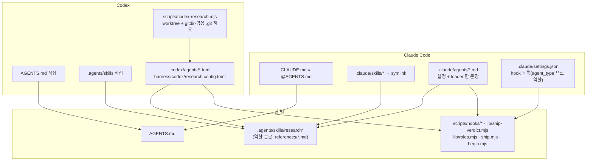

# 연구 체인의 Claude Code · Codex 대응

이 저장소의 연구 체인을 두 harness 에서 같은 절차로 돌리기 위한 유지보수 문서다. 체인을 고치거나, Claude Code 나 Codex 가
바뀌었을 때 이 문서로 시작한다. 설치는 `README.md`, 규칙이 생긴 이유는 `docs/method-provenance.md` 가 갖는다.

**한 곳만 고친다.** 지침, 역할의 행동, 판정은 한 벌이다. harness 파일에는 설정과 "본문을 읽어라" 한 문장만 있고,
`node scripts/check-harness.mjs` 가 어긋남을 CI 에서 막는다. 같은 내용을 두 파일에 써야 할 것 같으면, 그것을 공용 파일로
옮길 수 없는 이유부터 이 문서에 적는다.



## 1. 대응표

"확인"은 그 행을 마지막으로 실측한 버전과 방법이다. 버전이 오르면 `node scripts/check-harness.mjs --versions` 가
다시 볼 행을 알린다.

| # | 개념 | Claude Code | Codex | 확인 |
|---|---|---|---|---|
| 1 | 저장소 지침 | `CLAUDE.md` 의 `@AGENTS.md` import | `AGENTS.md` 를 직접 읽는다 | 문서 [C-memory], [X-agentsmd] |
| 2 | skill | `.claude/skills/<이름>` → `.agents/skills/<이름>` symlink. Claude 는 `.agents/` 를 읽지 않는다 | `.agents/skills/` 를 직접 읽는다 | check-harness `skill-link`; 문서 [C-skills], [X-skills] |
| 3 | researcher 진입 | research skill → `researcher` subagent(`isolation: worktree`, `background: true`) | research skill → 관리형 감독 agent(가능할 때) 또는 소유자 turn → `scripts/codex-research.mjs --run` → 별도 worktree 의 profile 세션. 감독자가 JSON 완료 이벤트와 게이트·PR 을 확인한다. 직접 `researcher` subagent 는 없다 | V3·V5 는 연구자 내부 절차. 2026-10-30 Paseo Codex agent 의 완료 알림·runner 시험 (§3) |
| 4 | 역할 정의(researcher, plan-review, lens-numbers, lens-reader, recheck) | `.claude/agents/<역할>.md` | `.codex/agents/<역할>.toml`, researcher 는 profile 의 `developer_instructions` | check-harness `roles`·`loader`·`loader-only`·`description` |
| 5 | lens 띄우기 | Agent 도구, `subagent_type`, 한 메시지에 둘. 대화형 세션에서는 background 로 돈다(Claude Code 기본) | `spawn_agent`, `agent_type`, `fork_turns:"none"` | V3·V5 |
| 6 | lens 맥락 격리 | 이름 있는 subagent 는 새 맥락으로 시작한다. 띄운 프롬프트를 start 기록에 남긴다 | 모델이 `fork_turns` 를 고른다(probe 에서 `"all"` 을 골랐다). `"none"` 이 아니면 pretool 이 거부한다. hook 입력의 spawn 메시지는 암호화돼 있어 남기지 않는다 | V3 프롬프트 기록(Claude), hooks.test, probe 2026-10-27 |
| 7 | lens 병렬 | 같은 메시지의 두 Agent 호출 | profile `[agents] max_concurrent_threads_per_session = 4` | 판정: start 둘이 첫 done 보다 앞선다 |
| 8a | Codex profile 설치 | 해당 없음 | 시작 스크립트가 부를 때마다 `harness/codex/research.config.toml` 을 `${CODEX_HOME}/research.config.toml` 로 복사하고 `[hooks.state]` 를 이어 붙인다 | V3(Codex) 2026-10-27: 저장소 파일이 바뀌지 않았다 |
| 8 | researcher 권한 | `.claude/settings.json` 의 PreToolUse 가 `agent_type` 이 연구 역할일 때만 허용한다. 소유자 세션에는 아무것도 정하지 않는다 | permission profile `research` + 시작 스크립트의 `research-run`(상속 + 정확한 gitdir 와 공용 .git 쓰기) | 2026-10-29: 공용 `.git/objects` 를 빠뜨리면 `begin.mjs` 의 `hash-object -w` 가 read-only 로 실패; 두 경로 허용 뒤 preflight 통과 (Codex 0.164.0) |
| 9 | lens 쓰기 막기 | `disallowedTools` + pretool 의 쓰기 도구 거부 | pretool 이 `agent_type` 으로 `apply_patch` 거부 | hooks.test |
| 10 | 검토 시작 기록 | settings 의 PreToolUse(Agent), `agent_type` = researcher 일 때만 | profile 의 `SubagentStart`(matcher = REVIEWERS) | hooks.test, V3·V5 |
| 11 | 검토 완료 기록 | settings 의 `SubagentStop`(matcher = REVIEWERS) | profile 의 `SubagentStop`(matcher = REVIEWERS) | hooks.test, V3·V5 |
| 12 | 게이트 | settings 의 `SubagentStop`(matcher = `^researcher$`) → `gates.mjs` | profile 의 Stop → `gates.mjs`; `ship.mjs` 와 같은 기본 원문 cache 를 읽어야 한다 | V3·V5, 2026-10-29 paper cache 불일치 수정 |
| 13 | hook 등록 위치와 trust | agent frontmatter 의 `hooks` 는 폴더 trust 가 있어야 돈다. 저장소 root 가 trust 되지 않았거나 trust 를 줄 수 없는 세션(Paseo 가 띄운 stream-json 세션, `claude -p`)에서는 하나도 돌지 않았다(2.1.317 실측). trust 와 상관없이 돌지 않는다는 보고도 있다([#95650](https://github.com/anthropics/claude-code/issues/95650)). `.claude/settings.json` 의 hook 은 같은 세션에서 돌았다. 그래서 모든 hook 을 `.claude/settings.json` 에 두고, payload 의 `agent_type` 으로 역할을 가른다. settings 의 hook 은 이 저장소의 모든 세션에 걸리므로 스크립트는 연구 역할이 아니면 넘긴다. check-harness `claude-hooks` 가 frontmatter 에 hook 이 다시 생기면 막는다. settings·agent 정의·skill 본문은 researcher 를 띄운 소유자 세션의 checkout 에서 읽히고, hook 명령도 그 checkout 의 `$CLAUDE_PROJECT_DIR/scripts/hooks` 를 돈다. 소유자 세션이 이 등록이 없는 브랜치에 있으면 hook 이 없다 | `/hooks` 의 hash trust. 기록은 profile 파일의 `[hooks.state]` 에 쓰인다(그래서 profile 은 symlink 가 아니라 복사본). `--run` 은 Codex `hooks/list` 가 계산한 현재 hash 와 저장된 hash 를 비교한 뒤에만 요청을 넘긴다. trust 전에 시작한 turn 에서는 SubagentStart·SubagentStop 이 돌지 않는다 | V3(Claude), V5·V3(Codex) 2026-10-27; 2026-10-30 낡은 hash 거부 실측; 2026-11-07 Paseo 세션에서 띄운 Claude run 에서 frontmatter hook 이 하나도 돌지 않아 lens 기록이 비었다(PR #53, `~/.claude.json` 에 저장소 trust 없음). settings 로 옮긴 뒤 haiku probe 에서 lens start(프롬프트 포함)·done, 게이트, modelLog, 거부 실측 |
| 14 | 모델 관찰(보조) | researcher transcript, lens 의 PostToolUse `resolvedModel`·`modelsUsed`(foreground 만). V3 에서 행위자 4/4, v8(background lens) 에서 5/5 | `logs_2.sqlite` 의 "server reported model". 0.164.0 실제 서버 세션에서는 0줄이라 늘 "확인 못 함" | §2 임시 어댑터 |
| 15 | 사용량 | `scripts/hooks/usage/claude.mjs` | `scripts/hooks/usage/codex.mjs`(thread 누적, 자식 모름) | V3·V5 hooks.json `usage` |
| 16 | 서명 | `Co-Authored-By: Claude` | `Generated-with: Codex CLI` | ship.mjs `ATTRIBUTION` |
| 17 | lens 가 읽는 동안 | 렌즈 start 때 `.research/lens-window.json` 을 열고 두 done 에 닫는다. 편집 도구로 문서·원장을 쓰면 pretool 이 거부, 셸로 바뀌면 PostToolUse(Bash) 의 `window.mjs` 가 바뀐 파일을 알린다 | 같은 창을 SubagentStart·Stop 이 연다·닫는다. `apply_patch` 의 파일 줄로 거부, PostToolUse(`Bash`/`apply_patch`) 로 알림 | hooks.test, 창 없을 때 호출당 약 19ms(빈 node 13ms) |
| 18 | recheck 상한과 띄우는 방식 | 여섯 번째 recheck 를 pretool 이 거부(막는 지적이 없어질 때까지 고치되 다섯 번에서 멈춘다). 검토 역할은 `run_in_background: false` 인 새 Agent 호출로만 띄우고, researcher 의 SendMessage 는 거부한다. ship 뒤 문서가 바뀐 채 끝나려 하면 gates.mjs 가 막는다 | 상한은 같음 | hooks.test; 2026-11-07 PR #54: background 로 이어 부른 recheck 가 start 없이 돌아 draft, 결과는 소유자 세션으로 갔다 |
| 19 | 검토 모델 등급 | `scripts/lib/roles.mjs` 의 TIER·MODEL, check-harness `role-model`. lens-reader·plan-review 는 frontier(opus), lens-numbers·recheck 는 workhorse(sonnet) | frontier·workhorse 모두 gpt-6.1-sol 로 시작(astra 는 이 체인에서 시험 전). researcher 는 profile `model` 로 sol 고정 | 2026-10-28: workhorse high 가 함정을 잡아 원문 대조는 workhorse 유지. 2026-11-08: workhorse lens-reader 가 메시지 없는 문서 셋(PR #52·#54·#55)을 통과시켜 판단 역할만 frontier 로 올렸다. Codex 확인: 새 역할 toml 은 등록 없이 `agent_type` 으로 잡히고, matcher 변경은 hook 재신뢰가 필요하다 |
| 20 | 역할 effort | `scripts/lib/roles.mjs` 의 harness 별 EFFORT. agent frontmatter `effort`. researcher high, lens-reader·plan-review medium(Opus, 입력이 짧거나 한 문서 읽기), lens-numbers·recheck high | 모든 역할 high. lens·recheck·plan-review 는 `.codex/agents/*.toml`, researcher 는 profile 의 `model_reasoning_effort` | 2026-10-28: 정하지 않은 Claude lens 가 세션 기본을 물려받아 Codex 와 달랐다. 2026-11-08: 분석·계획·문장이 모두 researcher 에서 나와 Claude researcher 를 high 로 올렸다. check-harness `role-effort` |
| 21 | job 사용량 | `scripts/lib/usage/claude.mjs`: researcher worktree 이름(agent-<id>)으로 기록을 찾고 `meta.json` 의 `parentAgentId` 로 자손을 골라 `bunx ccusage@latest claude session` 에 넘긴다 | `scripts/lib/usage/codex.mjs`: `CODEX_THREAD_ID` 와 worktree cwd 로 research 세션을 찾고 rollout 의 `thread_spawn.parent_thread_id` 로 자손(보조 agent 포함)을 골라 `bunx ccusage@latest codex session` 에 넘긴다. 2026-10-28: 부모 1·자식 3 에서 thread 별 마지막 누계 합 = 고유 response 118개 합 = adapter 12,114,142 tokens. 역할은 root=researcher, 자식은 `agent_role`(없으면 default). sandbox 안에서 `CODEX_THREAD_ID` 가 보인다 | ship.mjs 가 commit 직전에 `run.json` 의 `usage` 와 PR 본문 표에 역할별 토큰 유형(input·cache write·cache read·output)과 API 환산 금액을 남긴다. 금액을 모르는 역할은 미확인. 세션 id 는 남기지 않는다. Codex research 권한에 `~/.bun/install/cache`·`~/.cache/ccusage` 쓰기가 있어야 한다 |

```json verified
{
  "claude-code": { "version": "2.1.311", "recheck": ["2", "5", "6", "10", "11", "13", "14"] },
  "codex": { "version": "0.164.0", "recheck": ["3", "5", "6", "7", "8", "10", "11", "13", "14"] }
}
```

문서: [C-memory] https://code.claude.com/docs/en/memory · [C-skills] https://code.claude.com/docs/en/skills ·
[C-agents] https://code.claude.com/docs/en/sub-agents · [C-hooks] https://code.claude.com/docs/en/hooks ·
[X-agentsmd] https://developers.openai.com/codex/guides/agents-md · [X-skills] https://developers.openai.com/codex/skills ·
[X-agents] https://developers.openai.com/codex/subagents · [X-hooks] https://developers.openai.com/codex/hooks ·
[X-perm] https://developers.openai.com/codex/permissions · [X-app] https://developers.openai.com/codex/app-server

## 2. 임시 어댑터

공식 수단이 없어서 둔 것이다. 제거 조건이 생기면 지운다.

| 어댑터 | 왜 있나 | 깨지는 신호 | 제거 조건 |
|---|---|---|---|
| `scripts/codex-research.mjs` | Codex sandbox 는 linked worktree 의 gitdir 과 공용 `.git` 을 읽기 전용으로 두고, gitdir 은 worktree 를 만든 뒤에 정해진다 | begin 의 `git` preflight 실패 | `codex --worktree` 가 두 경로 쓰기를 허용하거나, permission 에 gitdir 을 가리키는 공식 토큰이 생길 때 |
| `scripts/hooks/model/codex.mjs` | hook 의 `model` 은 요청한 모델이다. 실제 모델은 Codex 자신의 SQLite 로그에만 남는다 | PR 의 모델 확인이 계속 "확인 못 함" | hook 이 `model/rerouted`(app-server 에는 있다)나 실제 모델을 받을 때 |
| `scripts/hooks/model/claude.mjs` 의 transcript 읽기 | subagent 안의 모델 전환은 PostModelSwitch 를 부르지 않는다 | researcher 의 모델 관찰이 빈다 | subagent 의 모델 전환이 hook 으로 올 때 |

## 3. 검증

| 이름 | 무엇 | 어떻게 |
|---|---|---|
| 정적 | 정의가 한 원본을 가리키고 본문이 loader 한 문장 | `node scripts/check-harness.mjs` (CI) |
| 판정표 | 절차를 어긴 기록이 정상 PR 이 되지 않는다 | `node scripts/test/hooks.test.mjs` (CI) |
| V3 | 작은 수정 요청 하나를 fixture 에서 끝까지 | 로컬 bare remote 를 origin 으로, `gh` 는 가짜. hook 기록과 `gh pr create` 인자를 본다 |
| V5 | 실제 연구 하나를 Codex 대화형 세션에서 | V3 와 같은 fixture. Claude 가 같은 출처로 쓴 문서와 견준다 |
| Codex 감독 실행 | 실패·완료 이벤트가 소유자에게 결과를 돌린다 | `scripts/test/codex-research-runner.test.mjs`: 가짜 Codex 의 용량 오류 뒤 같은 thread 재개, PR 없는 완료·오래된 Stop 게이트·새 요청의 과거 PR 재사용 거부. 2026-10-30 Paseo 자연어 인계는 별도 감독자와 연구자 worktree 를 실제로 열어 #45 를 만들었지만, 종료 hook 의 논문 cache 실패로 감독 실행의 verified PR 판정에는 이르지 못했다 (§5) |
| 문서 품질 | 절차 게이트와 별도로 독자가 설명·그림을 읽고 판단한다 | #44·#45 는 check-doc·check-prose·check-claims 를 통과했지만 소유자는 시각화 품질을 불합격으로 평가했다. 도식 비율은 진단 값이며 합격 판정이 아니다 (§5) |
| 같은 문서의 PR | 별도 worktree 가 같은 slug 에 경쟁 PR 을 열지 않는다 | `ship.mjs` 는 commit/push 전에 같은 slug 의 다른 열린 PR 을 확인한다. `scripts/test/ship-prs.test.mjs` 는 다른 fix 브랜치와 같은 브랜치를 구분하고, 충돌 시 실제 ship 과정이 commit/push 전에 멈추는지 확인한다 |

결과는 §5 에 날짜와 함께 적는다.

## 4. harness 가 바뀌었을 때

1. `node scripts/check-harness.mjs --versions` 로 다시 볼 행을 확인한다.
2. 그 행의 공식 문서에서 바뀐 것을 찾는다. 새 hook 이벤트, agent 정의 필드, permission, skill 위치를 특히 본다.
3. 공식 수단이 생겨 §2 의 어댑터를 지울 수 있으면 지운다.
4. 판정표와 V3 를 그 harness 로 다시 돌리고, 행의 "확인"과 위 `verified` 블록을 고친다.
5. 지침을 바꿔야 하면 공용 파일만 고친다. harness 파일을 고쳐야 한다면 그것은 설정이어야 한다.

### 2026-10-30 Claude Code 2.1.312 문서 점검

이 점검은 공식 문서와 설치 버전의 정적 대조다. `verified` 의 2.1.311 실측을 대체하지 않는다.
`claude plugin validate .claude/agents` 와 `node scripts/check-harness.mjs --versions` 는 통과했다.
공용 skill 은 `skill-creator/scripts/quick_validate.py .agents/skills/research` 로 검증했다.
`claude plugin validate .claude/skills/research` 는 plugin manifest 를 요구하므로 skill 검증 명령이 아니다.
2.1.312 에서 실제 연구를 띄워 hook·worktree·PR 을 끝까지 확인하지는 않았다.

| 점검 대상 | 공식 동작과 이 저장소의 대응 | 남은 확인 |
|---|---|---|
| skill 선택 | [Skills 문서](https://code.claude.com/docs/en/skills)는 project skill 디렉터리 symlink 를 지원한다. `context: fork` skill 은 이전 대화를 보지 못하므로, 공용 `research` skill 은 소유자 맥락에서 요청의 기존 각도를 모아 이름 있는 `researcher` 를 첫 경로로 띄운다. `.claude/skills/research` 는 `.agents/skills/research` 를 가리킨다 | 자연어 요청에서 Claude 가 native `researcher` 를 선택하고 Codex 감독 실행기를 부르지 않는지 |
| 연구자 안의 skill 체인 | [Subagents 문서](https://code.claude.com/docs/en/sub-agents)는 background subagent 의 도구 목록에 `Skill` 을 포함하고, `skills:` 에 미리 싣지 않은 project skill 도 실행 중 호출할 수 있다고 명시한다. `researcher.md` 는 공용 본문을 읽어 `research-source` → `research-doc` → `research-verify` 로 넘긴다 | 세 skill 의 호출 순서와 같은 저자 맥락 유지, 검증 lens 의 별도 맥락을 볼 것 |
| 연구자 격리와 완료 | [Subagents 문서](https://code.claude.com/docs/en/sub-agents)는 `background: true` 와 `isolation: worktree` 를 frontmatter 필드로 정의하고, 백그라운드 완료를 다음 turn 의 알림으로 돌린다. Agent Teams 세션에서 호출에 인스턴스 `name` 을 주면 teammate 로 바뀌어 frontmatter 의 격리가 적용되지 않을 수 있다. 공용 skill 은 agent type 으로, 인스턴스 이름 없이 호출하도록 명시한다. `.claude/agents/researcher.md` 의 두 필드는 이번 수정에서 바뀌지 않았다 | 별도 worktree 시작, 완료 알림, 원래 checkout 보존. Agent Teams 가 켜져도 teammate 로 변하지 않는지 |
| 렌즈 맥락·병렬 | 같은 문서는 일반 subagent 가 부모 대화 없이 시작하고, 백그라운드 subagent 도 `Agent` 도구를 유지하며, 기본 중첩 깊이가 세 층이라고 설명한다. 현재 연구자 → 두 lens 구조와 `begin.mjs` 의 최소 깊이 2 점검에 맞는다 | 두 lens `start` 가 첫 `done` 앞에 기록되는지, lens 가 저자 대화를 받지 않는지 |
| hook 과 trust | [Subagents 문서](https://code.claude.com/docs/en/sub-agents)는 subagent frontmatter `Stop` 을 `SubagentStop` 으로 바꾸고, project agent 파일의 폴더를 trust 하지 않으면 frontmatter hook 을 건너뛴다고 명시한다. 부모 폴더 trust 와 `claude -p` 는 그 trust 를 대신하지 못한다. [Permissions 문서](https://code.claude.com/docs/en/permissions)는 Git worktree 의 trust 키가 main checkout root 이고, PreToolUse 의 `allow` 가 deny·ask 규칙을 우회하지 못한다고 설명한다 | trust 된 대화형 세션에서 researcher·lens hook 실행, `hooks.json` 의 start/done 짝과 Stop 게이트, 실제 권한을 볼 것 |
| 설치 버전의 변화 | [2.1.311 릴리스](https://github.com/anthropics/claude-code/releases/tag/v2.1.311)는 실행 중 `SubagentStop` 반복과 자식 작업 중 worktree 조기 삭제를 수정했다. [2.1.312 릴리스](https://github.com/anthropics/claude-code/releases/tag/v2.1.312)는 prompt/agent 형식 hook handler 의 동시 실행 상한을 바꿨다. 이 저장소의 Claude hook 은 command 형식이므로 후자의 직접 영향은 예상하지 않는다 | 실제 hook 기록으로 중복·누락 여부를 확인할 것 |
| 안전장치 뒤 모델 전환 | [2.1.312 릴리스](https://github.com/anthropics/claude-code/releases/tag/v2.1.312)는 flagged message 뒤 자동 모델 전환 범위를 넓혔다. `.claude/settings.json` 에는 `CLAUDE_CODE_DISABLE_REFUSAL_FALLBACK=1` 이 있어 이 경로를 끄도록 설정돼 있다 | researcher subagent 에 설정이 전달되는지, 안전장치 오류 후 공용 skill 의 새 맥락 재시도가 한 번만 실행되는지 |
| 공용 cache 변경 | `pin-paper.mjs` 와 `check-claims.mjs` 가 같은 새 기본 경로 `~/.cache/research-library/papers` 를 쓰고, 검증기는 이전 `~/.research-papers` 를 읽기 fallback 으로 둔다. 논문 경로 시험 16/16에는 새 기본값·이전 fallback·새 cache 변조 차단이 포함된다. Claude 전용 설정 파일과 연구자 정의는 바뀌지 않았다 | Claude 연구자 권한에서 새 cache 쓰기와 기존 문서 검증을 확인할 것 |

나중에 Claude 측에 검토를 맡길 때에는 **이번 diff 가 Claude 경로를 바꾸는 지점**을 먼저 읽게 한다:
공용 `research/SKILL.md` 의 진입 우선순위, `begin.mjs` 의 preflight 보고,
`pin-paper.mjs`·`check-claims.mjs` 의 cache 기본값과 fallback. V3 fixture 에서
native `researcher` 호출 → 별도 worktree → 두 lens 의 병렬 start/done → Stop 게이트 →
PR 결과까지 확인하도록 요청한다. 실전 요청을 종단 시험으로 실행하기 전에는 소유자에게 알린다.
`claude -p` 는 project agent frontmatter hook trust 를 충족하지 못하므로 이 검토의 실전 경로로 쓰지 않는다.

## 5. 알려진 한계와 실측 기록

- researcher 는 셸로 `notes/hooks.json` 을 위조할 수 있다. 막는 것은 lens 를 건너뛰거나 hook 이 빠지는 경우이고, 도구로
  그 파일을 고치는 것은 hook 이 거부한다.
- 두 harness 모두 subagent 가 실제로 쓴 모델을 hook 에 주지 않는다. 모델 확인은 보조 관찰이다.
- Claude 에서 lens 를 background 로 띄우면 응답 모델이 오지 않는다. 그 run 의 모델 확인은 "확인 못 함"이 된다.
- 2026-10-29 Codex 대화형 TUI 의 모델 용량 오류 뒤에도 `.research/active.json` 은 `running` 이었다.
  이 값은 `begin.mjs` 통과 기록이다. `--run` 은 `codex exec --json` 의 완료·실패 이벤트를 읽고
  `.research/codex-job.json` 에 turn 상태를 쓰며, 일시 오류를 같은 thread 에서 최대 두 번 재개한다.
  안전장치 오류 뒤 스킬이 요구하는 새 연구자 맥락은 `--fresh-thread --resume` 으로 같은
  worktree 에서 열고, 이전 오류와 원래 요청을 새 thread 에 전달한다.
  종료할 때 ship 게이트·ship 뒤 Stop 게이트·열린 PR 을 함께 확인한다. 대화형 TUI 로 직접 연 연구는
  여전히 소유자 turn 에 실패·완료를 자동 전달하지 않는다.
- Codex 0.164.0 의 `codex exec --json` 실패 이벤트에는 오류 메시지만 있고 `codexErrorInfo` 가 없다.
  감독 실행기는 확인된 용량·일시 오류 문구만 자동 재시도한다. 다른 실패도 `failed` 로 보고하지만
  자동 재시도하지 않는다. 오류 종류별 안정적인 분기에는 app-server 의 `turn/completed` 오류 코드가 필요하다.
- 일반 Codex owner 세션의 subagent 는 부모 sandbox 와 권한을 상속하고 자식별 worktree 인자가 없다.
  현재 연구자 profile 의 권한·hook 을 직접 subagent 정의 하나로 옮길 수 없다. 별도 권한과 완료 알림을
  제공하는 관리형 agent 가 있으면 그 agent 가 `--run` 을 기다렸다가 소유자에게 보고한다. 2026-10-30 Paseo
  Codex agent 는 이 알림 경로를 실측했다. 그런 agent 가 없으면 소유자 turn 이 종료까지 살아 있어야 한다.

### 독자 과업 판정과 설명 본문 수정 (2026-11-04)

두 harness 는 조사·집필·검토 본문을 공유한다. 이번 수정은 공용 skill, 셸, 검사와
출고 판정에 적용하며 모델·effort·agent 수는 바꾸지 않는다.
독자의 구체적 과업 시연은 기존 검토 보고서에 남긴다. 별도 `readerCheck` 필드 의무화는
효과 미확인과 기존 실행 호환성 때문에 철회했다. 기존 기록에 새 필드가 없다는 이유로
출고 상태를 바꾸지 않는다. `unfixed`의 `impact: understanding`은 `meaning: false`여도
draft다. 이 분류 역시 검토 결과를 작성자가 기록하며 기계가 이해도를 판정하지 않는다.

설명 문단을 본문으로 인정하고, 재검토도 수정된 설명이 독자 과업을 막는지 다시 본다.
배경 자료와 검증 한계는 `docs/method-provenance.md` 의 같은 날짜 항목을 따른다.
Claude Sonnet 5.5에게 Claude 하네스·스킬 계약을 별도로 검토시켰다. 공유 링크 resolve,
agent의 본문 참조, hook·보호 창·검토 상한, 기존 run 호환을 확인했다. 새 본문과 SVG를
넣은 fixture도 검사·텍스트 추출·1280/390 렌더를 통과했다. 추가 도구나 권한은 필요 없다.
미커밋 수정은 새 연구 worktree에 자동 반영되지 않으므로, 일반 launcher를 호출하는
것만으로 이 수정안을 종단 시험했다고 할 수 없다.
이후 Codex에서는 수정안을 적용한 새 worktree로 실제 연구를 완료했다([PR #48](https://github.com/kywoo26/research-library/pull/48)).
과거 발행물·원장·검토 자료를 sparse checkout에서 제외하고 새 Sol high thread를 열었다.
ship과 종료 hook의 세 검사가 통과했고, 병렬 lens와 마지막 recheck의 문서 hash가 맞았다.
새 문서만 origin/main 검사기로 검사한 결과도 통과했다. 세션 설정은 Sol high로 기록됐지만
서버 모델 관측은 비어 있으므로 실제 서버 모델을 독립 확인했다는 뜻은 아니다.
Claude의 새 문서 작성부터 PR까지 실행한 전후 비교는 완료하지 않았다.

sparse checkout에서 제외한 root 생성물을 출고 시 복원하려고 ship의 checkout에
`--ignore-skip-worktree-bits`를 쓴다. 이 복원은 집필과 검토가 끝난 뒤에 일어나고,
생성물은 연구 커밋에 포함하지 않는다. 원고 격리는 이 실행의 준비 절차였으며,
일반 launcher가 모든 연구에서 과거 원고를 자동 제외하도록 바뀐 것은 아니다.

### 실측 기록

| 날짜 | 무엇 | harness | 결과 |
|---|---|---|---|
| 2026-10-27 | V3: 기존 문서 표지 답 문단 줄이기 | Claude Code 2.1.310, researcher opus·lens sonnet | 정상 PR. lens 둘 겹침(start 16:02:08·16:02:11, 첫 done 16:02:30), 짝 3, 모델 확인 4/4 |
| 2026-10-27 | V5: arXiv 2610.14224 새 문서(Claude 원본과 같은 질문) | Codex 0.164.0, gpt-6.1-sol high | draft PR. 요청을 첫 프롬프트로 넘겨 trust 전에 turn 이 시작됐고 SubagentStart·Stop 이 돌지 않았다. lens 는 실제로 겹쳐 돌았고 세 번 모두 `fork_turns:"none"`. researcher 는 기록을 꾸미지 않고 그 사실을 PR 에 적었다 |
| 2026-10-27 | V5 블라인드 비교 | 독립 검토자, 숫자 24개를 논문에 대조 | Claude 원본이 약간 낫다(첫 화면, 정량 비교, 등급). Codex 문서는 틀린 숫자 0/12, 게시 가능. Claude 원본에는 library 효과 판정의 오독이 하나 있었다 |
| 2026-10-27 | probe: lens 정의의 model 고정 | Codex 0.164.0 | 세션 gpt-6.1-sol, lens 정의 gpt-6-luna → 자식 thread 는 gpt-6-luna 로 돌았다(rollout turn_context). 고정이 적용된다 |
| 2026-10-27 | V3: 위와 같은 수정, 고친 시작 스크립트 | Codex 0.164.0 | 정상 PR. `/hooks` trust 뒤 요청 입력, SubagentStart·Stop 이 actor 로 짝지어 기록, lens 둘 겹침(start 16:31:35·16:31:46, 첫 done 16:32:08), 저장소 profile 파일 그대로 |
| 2026-10-28 | v5: claude-obsidian, 렌즈 frontier(opus, astra), 함정 T1–T6 대조 | 두 harness | Codex 정상 PR(18분, 주간 한도 2%), 틀린 주장 0이지만 함정 대부분을 다루지 않음. Claude draft(33분, 약 $16, 비용의 84% 가 researcher 의 맥락 재읽기), recheck 4회. Claude 는 T1(opus 렌즈가 `capabilities.json` 을 열고도 놓침)과 T4(렌즈가 도는 동안 새로 쓴 문장)를 틀림 → 창 hook·recheck 상한을 넣고 렌즈를 workhorse 로 되돌림 |
| 2026-10-28 | v7: v5 와 같은 요청·pin, 렌즈 workhorse, 창 hook·recheck 상한·claims 의 원장 id 참조 | 두 harness | Claude 25분, Claude Code 표시 $13.73(v5 $19.34). ccusage 로 센 researcher 이하는 $11.20 이고, 차이는 메인 세션 몫과 transcript 에 없는 Opus 요청이다(cache read 약 7.3M, 출력 거의 없음, v5 에도 같은 차이). researcher 호출 146(v5 173), 맥락 중간값 18.7만(23.7만), recheck 2. 주간 한도 79→80%(같은 구간 다른 세션 $2.16 포함). Codex 18분, input 1,071만(v5 955만), 주간 97% 남음 그대로. 두 run 모두 렌즈가 도는 동안 보호 파일 변경 없음. 블라인드 비교: Claude v7 이 v5 보다 약간 낫다(틀린 주장 2/12 대 3/12, T4 해결, T1 여전, T5 새로 틀림). Codex v7 과 v5 는 대체로 대등(둘 다 0/12). 둘 다 탁월하지 않다. 같은 날 같은 slug 를 두 harness 가 같은 원격에 올리면 뒤의 ship 이 덮어쓰지 않고 멈춘다 |
| 2026-10-28 | v8: v7 과 같은 요청·pin, 모든 역할 effort high(roles.mjs EFFORT), lens-numbers 가 동작 주장을 숫자처럼 훑기, research-source 가 선언·강제 지점을 먼저 열기 | 두 harness, 원격 따로 | Claude 37분, Claude Code 표시 $19.03(ccusage 로 센 researcher 이하 $16.15, v7 $11.20). lens-numbers 66회 호출(v7 12회), researcher 가 `capabilities.json` 을 14번 열었다(v7 0번). 마지막 recheck 가 찾은 뜻 차이 2건을 상한 때문에 고치지 않고 draft 로 열었다. 주간 한도 81→82%. Codex 14분, input 1,329만(v7 1,071만), 정상 PR, 주간 96% 남음 그대로. 블라인드 비교: Claude v8 이 v7 보다 분명히 낫다(틀림 2/12 대 4/12, T1·T5 해결, T6 처음 다룸, 표지 일반화와 T4 일부는 남음). Codex v8 이 v7 보다 약간 낫다(둘 다 0/12, registry·tiling 처음 다룸, T4 정확). 둘 다 탁월하지 않다 |
| 2026-10-29 | OpenCodeReview 갱신, PR #44 | Codex 0.164.0 | 첫 `begin.mjs` 는 공용 `.git/objects` 쓰기 부족으로 실패했다. 두 Git 경로를 허용한 뒤 preflight 는 통과했다. 논문 pin 을 허용된 `~/.cache/research-library/papers` 에 두어 `ship.mjs` 는 환경 변수로 검증했지만, 종료 hook 은 기존 기본값 `~/.research-papers` 를 찾아 실패했다. pin·검증 도구의 기본 cache 를 허용된 경로로 통일하고 이전 cache 를 읽기 fallback 으로 남겼다. 새 기본값에서 이 문서의 주장 71개 검증과 논문 경로 시험 13/13이 통과했다. 모델 용량 오류 뒤 `active.json` 이 `running` 으로 남은 문제는 위 §5 한계에 기록했다. |
| 2026-10-30 | [OpenCodeReview 재조사 PR #45](https://github.com/kywoo26/research-library/pull/45) | Paseo Codex gpt-6.1-sol high → 감독자 → Codex researcher | 자연어 요청에서 감독자와 연구자 worktree 까지 자동 인계해 문서 PR 을 열었다. `ship.mjs` 의 세 검사는 통과했지만 PR 은 논문 cache 를 사람이 처리해야 하는 draft 였고 종료 hook 도 실패했다. 연구자 worktree 는 `origin/main` 에서 열려 소유자 worktree 의 미커밋 cache 수정이 들어가지 않았다. 따라서 수정본의 종단 성공이나 cache 수정의 회귀로 세지 않는다. |

### OpenCodeReview 문서 품질 판정 (2026-11-02)

[PR #44](https://github.com/kywoo26/research-library/pull/44)는 수동 개입 뒤 ready,
[PR #45](https://github.com/kywoo26/research-library/pull/45)는 draft 다. 둘 다 같은
`research/2026-09-15-open-code-review/` 를 서로 다른 `-fix-<시각>` 브랜치에서 바꾸므로
경쟁 PR 이다. 당시 `ship.mjs` 는 현재 브랜치의 열린 PR 만 찾아 다른 브랜치의 같은 문서를 막지 않았다.

두 PR 의 본문은 도식이 든 본문 장을 각각 2/13(15%), 2/12(17%)로 기록한다. 두 작성자는
렌더링을 봤다고 기록했지만 소유자는 도식과 다이어그램이 설명에 거의 쓰이지 않아 두 문서의
시각화 품질을 불합격으로 평가했다. 정적 게이트 통과·렌더 확인·렌즈 완료는 **절차의 증거**이고,
독자가 구조와 판단 흐름을 이해할 수 있는지는 별도의 **문서 품질 판단**이다. 이 두 PR 은
Codex 결과의 품질 합격 근거로 쓰지 않는다.

공용 `research-doc` 의 오래된 문서 예외가 전면 갱신에도 옛 deck 문법을 유지하게 했고,
`check-doc.mjs` 는 2026-09-15 날짜와 board 표시가 없는 문서에 board 문법을 요구하지 않았다.
`ship.mjs` 의 도식 비율은 보고 값일 뿐 차단 조건이 아니었다. 이 경로는 Claude 와 Codex 가
공유한다. 현재 규칙은 국소 수정에서만 옛 문법을 유지하고, 전면 갱신에서는 board 셸을 쓰도록
좁혔다. 렌즈 A 는 렌더 화면에서 구조를 실제로 읽을 수 있는지 점검한다. 도식 비율에 고정
합격선을 두지는 않는다. 같은 slug 의 다른 열린 PR 은 commit/push 전에 막는다.
